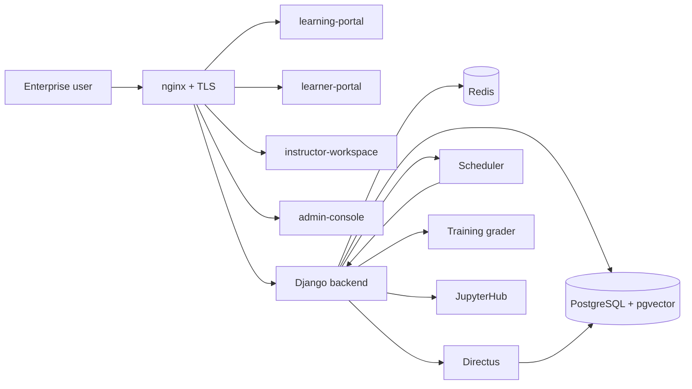
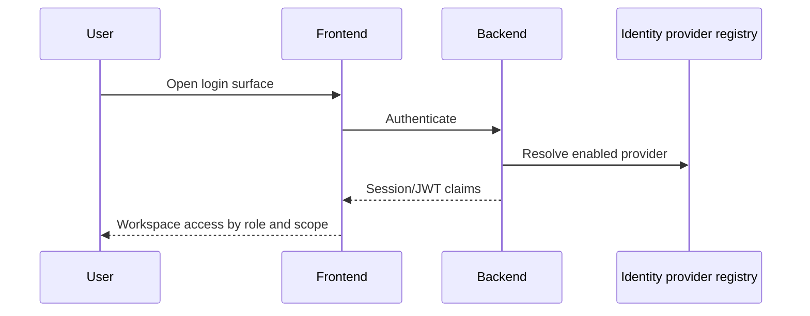
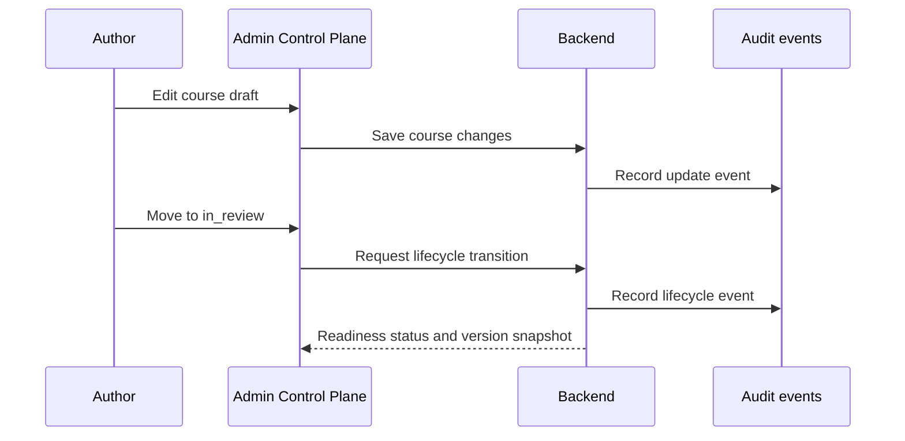
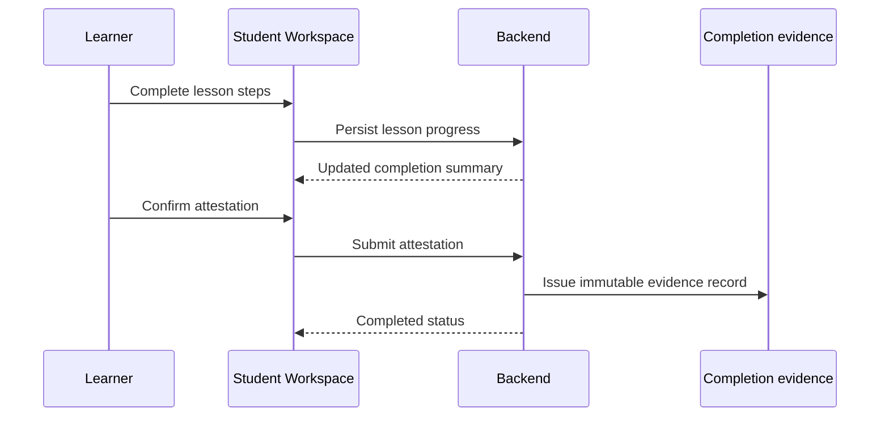

# Architecture And Data Flow

This document describes the platform architecture and the main operational data paths for `Hefner Sprach Hub`.

## 1. System architecture

## 2. Production stack layout

Upper infra stack:

- `nginx`
- `certbot`
- `postgres`
- `redis`
- `directus`
- backup jobs

App stack:

- `backend`
- `scheduler`
- `traininggrader`
- `jupyterhub`
- `learning-portal`
- `learner-portal`
- `instructor-workspace`
- `admin-console`

Reference:

- [DEPLOYMENT_SPLIT_STACK.md](DEPLOYMENT_SPLIT_STACK.md)

## 3. Identity and access flow

Current implementation:

- local password sign-in is active
- identity providers are modeled as first-class records
- provider readiness is surfaced in admin reporting
- Microsoft Entra and Google Workspace are represented as activation-ready providers

## 4. Content governance flow

## 5. Learner completion and evidence flow

## 6. Data categories

Primary operational data:

- user and profile identity data
- course, module, lesson, and section content
- cohort, schedule, and attendance data
- learner progress and completion evidence
- audit and governance records
- AI and knowledge operations metadata

Supporting data:

- media assets
- recordings and resource links
- Directus sync metadata
- background job telemetry

## 7. Trust boundaries

Boundary 1: public internet to `nginx`

- TLS termination
- route separation by surface

Boundary 2: frontend surfaces to backend API

- authenticated requests
- role-based workspace access

Boundary 3: backend to infrastructure services

- database
- cache
- Directus
- background services

Boundary 4: optional external service integrations

- Microsoft Teams / Outlook / Planner links
- optional AI provider
- optional identity provider activation

## 8. Security-sensitive components

Security-sensitive components include:

- Django backend
- PostgreSQL database
- Directus content plane
- identity provider settings
- Jupyter and grader runtime controls
- audit and completion evidence records

## 9. Recommended diagram usage

Use this document:

- in security review packages
- during technical due diligence
- inside pilot proposals for enterprise customers
- as the architecture section of the vendor deck
